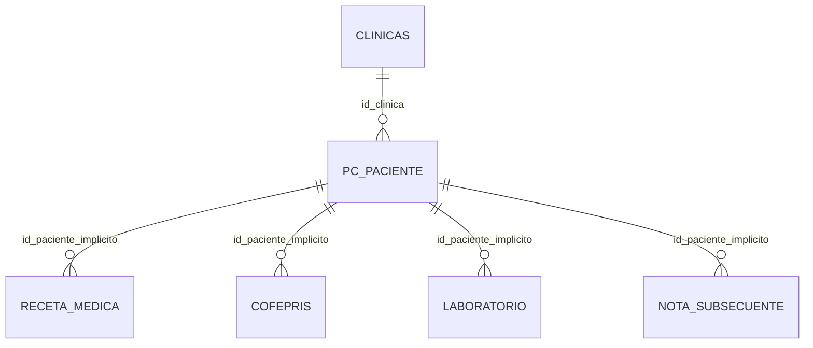
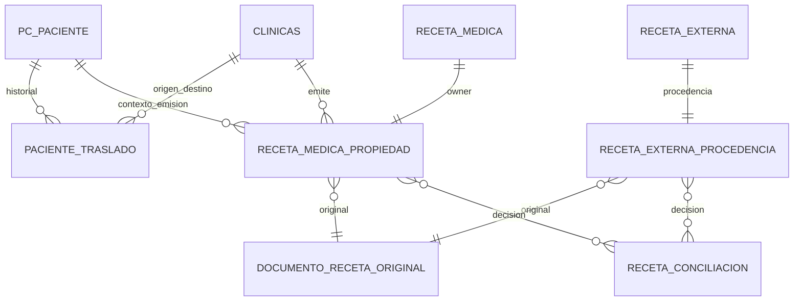

# TH-SEC-ARCH-01 — Propuesta de modelo de datos

Estado: **PROPUESTA — NO IMPLEMENTADA**  
Base de referencia: `clinica_dolor_demo_20261010_final`  
Base prohibida para escrituras: `bd_clinica`

Este documento separa el esquema observado del modelo recomendado. Ninguna tabla, columna, FK, índice o restricción de este documento existe actualmente por el hecho de estar descrita aquí. No es una migración ejecutable.

## 1. Estado actual verificado

Hechos de la base sintética:

- MariaDB 10.4.32, InnoDB.
- `pc_paciente.id` es PK; `id_clinica` tiene índice y FK de fixture a `clinicas.id`.
- `receta_medica.id` es PK; `id_paciente` sólo está indexado y no tiene FK declarado.
- `receta_medica` no tiene clínica emisora, usuario emisor, owner inmutable, documento original ni hash.
- `receta_medica_externos` no existe en la base allowlisted.
- No se encontraron tablas de traslados, auditoría de propiedad, usuarios o roles en esa base.

## 2. Modelo recomendado

### 2.1 `paciente_traslado` — PROPUESTO, NO EXISTE

| Campo | Regla propuesta |
|---|---|
| `id` | PK |
| `id_paciente` | FK `pc_paciente.id`, NOT NULL |
| `id_clinica_origen` | FK `clinicas.id`, NOT NULL |
| `id_clinica_destino` | FK `clinicas.id`, NOT NULL y distinta |
| `fecha_efectiva` | timestamp NOT NULL |
| `estado` | PENDIENTE/APROBADO/RECHAZADO/CANCELADO |
| `id_usuario_solicita` | referencia a catálogo de identidad real, pendiente de confirmar |
| `id_usuario_autoriza` | referencia a identidad real; sólo autoridad aprobada |
| `fecha_autorizacion` | nullable hasta aprobar |
| `motivo_referencia` | texto auditable |
| `created_at`, `cancelled_at`, `cancelled_by` | timestamps y actor, sin borrado físico |

Índices: paciente+fecha, origen+paciente, destino+paciente, estado. Regla: un solo traslado aprobado vigente; como máximo uno pendiente compatible. La actualización de `pc_paciente.id_clinica` sólo ocurre al aprobar, dentro de una transacción con bloqueo de fila.

### 2.2 `receta_medica_propiedad` — PROPUESTO, NO EXISTE

| Campo | Regla propuesta |
|---|---|
| `id_receta_medica` | PK y FK `receta_medica.id` |
| `id_paciente_emision` | FK a paciente; snapshot de contexto |
| `id_clinica_emisora` | FK `clinicas.id`, NOT NULL, inmutable |
| `id_usuario_emisor` | identidad del emisor, FK pendiente de catálogo real |
| `fecha_emision` | valor de emisión, no recalculado |
| `id_documento_original` | FK al documento privado |
| `estado_propiedad` | VERIFICADA/PENDIENTE_CONCILIACION/BLOQUEADA |
| `conciliacion_id` | FK nullable al expediente de conciliación |
| `created_at` | timestamp inmutable |

Una fila por receta, con owner permanente. Nunca se actualiza `id_clinica_emisora` como operación ordinaria.

### 2.3 `receta_externa_procedencia` — PROPUESTO, NO EXISTE

Sólo debe definirse después de confirmar la tabla externa real:

- `id_receta_externa`: FK a la tabla real.
- `id_paciente`: nullable hasta asociación inequívoca.
- `id_clinica_registro`: clínica que capturó el registro; no es automáticamente emisora.
- `tipo_emisor`: sistema, clínica externa o desconocido.
- `emisor_externo_nombre`/referencia externa.
- `id_clinica_emisora_sistema`: nullable, sólo si el emisor pertenece al sistema.
- `estado_procedencia`: VERIFICADA/PENDIENTE_CONCILIACION/BLOQUEADA.
- `id_documento_original`, fechas y auditoría.

No se debe transformar la clínica del usuario registrador en owner de una receta emitida fuera del sistema.

### 2.4 `documento_receta_original` — PROPUESTO, NO EXISTE

| Campo | Regla propuesta |
|---|---|
| `id` | PK |
| `storage_key` | clave privada aleatoria; no ruta pública predecible |
| `sha256` | hash de los bytes almacenados |
| `byte_size`, `mime_type` | metadatos verificables |
| `created_at` | fecha de persistencia |
| `estado` | ORIGINAL_INMUTABLE/NO_DISPONIBLE/BLOQUEADO |

El almacenamiento debe quedar fuera de exposición directa o tener protección equivalente comprobable. Las descargas se solicitan por ID de documento y se autorizan por receta/owner/traslado/operación.

### 2.5 `receta_conciliacion` — PROPUESTO, NO EXISTE

- receta y tipo de recurso;
- estado y owner previo;
- clínica candidata;
- evidencia y hash/referencia;
- solicitante y aprobador;
- decisión, justificación, fechas;
- snapshot anterior y auditoría de intentos rechazados.

Sólo el superadministrador puede aprobar. La conciliación no modifica campos clínicos ni sustituye el PDF original.

## 3. Relaciones y restricciones

Invariantes:

1. Una receta no puede tener dos owners activos.
2. El owner no cambia por editar `pc_paciente.id_clinica`.
3. Un traslado pendiente no habilita acceso.
4. Un documento original no se sobreescribe; una nueva versión es un evento separado y no sustituye la evidencia anterior.
5. Una receta sin owner o sin documento original fiel queda bloqueada o marcada pendiente.
6. No se asigna owner por la clínica actual del paciente.
7. Toda consulta de lectura, PDF, impresión, descarga, edición y eliminación ejecuta la misma autorización por recurso.

## 4. Política de legacy

| Estado | Acción |
|---|---|
| Owner y evidencia verificables | Registrar propiedad sin cambiar contenido |
| Evidencia documental suficiente | Conciliación superadmin |
| Ambiguo/no identificable | Pendiente o bloqueado; sin exposición cruzada |
| Sin PDF original | No presentar PDF regenerado como original |
| Documento no asociable | Mantener bloqueado hasta resolver |

No se propone actualizar masivamente `id_clinica`, copiar recetas a clínicas o generar PDFs sustitutos.

## 5. Implementación futura por etapas

1. Confirmar tabla real de usuarios/roles y recetas externas.
2. Aprobar tablas aditivas y restricciones.
3. Crear owner/documento para recetas nuevas dentro de la transacción de emisión.
4. Introducir el servicio de autorización por recurso.
5. Implementar traslados con estados y bloqueo de concurrencia.
6. Proteger almacenamiento y descargas.
7. Conciliar legacy sólo por superadmin.
8. Ejecutar matriz de regresión y obtener aprobación separada.

Ninguna etapa se ejecutó ni tiene SQL listo para ejecución.
