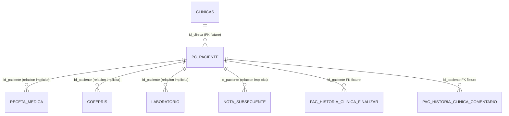
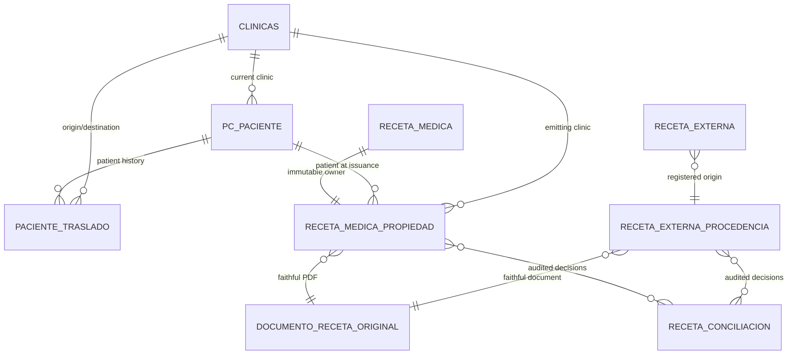

# TH-SEC-ARCH-01 — Arquitectura de propiedad histórica, traslados y conciliación documental

Fecha de corte: 2026-10-12  
Proyecto: Clínica del Dolor  
Modo: diagnóstico y diseño arquitectónico exclusivamente  
Implementación: **NO AUTORIZADA**  
Producción: **NO AUTORIZADA**

## A. Resumen ejecutivo

TH-SEC-FIX-01B demostró que el sistema actual sólo puede autorizar por la clínica vigente del paciente. No puede conservar la clínica emisora de una receta ni distinguir, después de un traslado, entre propietario, clínica destino y clínica ajena. Los PDF internos se regeneran desde datos actuales; las recetas externas no tienen propietario verificable en el entorno sintético; y el endpoint de descarga no recibe un recurso clínico que permita autorizarlo.

Esta propuesta define un modelo aditivo para:

- registrar traslados aprobados sin sobrescribir la historia;
- conservar owner permanente de recetas internas y externas;
- separar lectura/impresión/descarga de edición/eliminación;
- entregar sólo lectura a una clínica destino autorizada;
- conservar el PDF original con integridad verificable para documentos nuevos;
- mantener bloqueados los registros históricos ambiguos;
- permitir conciliación únicamente por superadministrador y con auditoría.

El diseño no se implementó. No se crearon tablas, migraciones, archivos, permisos ni datos. La Entrevista Conversacional queda fuera de alcance.

## B. Contratos aprobados

Se toman como decisiones de producto vigentes DEC-01 a DEC-10 de TH-SEC-ARCH-01:

1. La receta pertenece permanentemente a la clínica emisora.
2. Los traslados A→B→C conservan trazabilidad.
3. La clínica actual puede consultar el historial autorizado y obtener copias fieles.
4. La clínica destino no puede editar, eliminar ni cambiar emisor, clínica, fecha o contenido.
5. Una clínica anterior conserva acceso sólo a las recetas que emitió.
6. Una receta nueva pertenece a la clínica que la emite.
7. Los registros sin owner demostrable quedan pendientes y no se reasignan automáticamente.
8. Sólo el superadministrador puede conciliar registros históricos.
9. Un PDF regenerado no se presenta como el original.
10. Una clínica sin relación autorizada no obtiene acceso por conocer un ID o URL.

Las decisiones sobre asociaciones simultáneas, multiclínica, retorno B→A con acceso adicional y recetas emitidas fuera del sistema requieren confirmación adicional; no se infieren en este diseño.

## C. Preflight y esquema actual

| Dato | Resultado |
|---|---|
| Directorio | `C:\xampp\htdocs\clinica-dolor` |
| Rama | `Silvino` |
| HEAD | `1b08d9b4c41080c176fbe4588212863f3a1ac18c` |
| Worktree | Preservado; 101 entradas de estado previas, 49 modificadas y 52 no rastreadas antes de esta documentación |
| Base de inspección | `clinica_dolor_demo_20261010_final` |
| Base prohibida para escrituras | `bd_clinica` |
| Motor/version | MariaDB `10.4.32`, InnoDB |
| Escrituras realizadas | Ninguna |
| Entrevista Conversacional | Excluida; no se modificó ni se auditaron sus contratos |

La configuración de aplicación habitual apunta a `bd_clinica`; la inspección se conectó explícitamente a la base allowlisted para evitar depender de esa configuración.

### C.1 Tablas y relaciones observadas

| Tabla | Clave y campos relevantes observados | Relaciones declaradas observadas | Limitación |
|---|---|---|---|
| `clinicas` | PK `id`; nombre y datos de la clínica | Ninguna hacia otras tablas | No contiene historial de pertenencia |
| `pc_paciente` | PK `id`; `id_clinica` indexado; `fecha_alta`; `ultima_actualizacion`; datos demográficos | FK fixture `id_clinica → clinicas.id` | `id_clinica` es mutable y representa sólo la clínica actual |
| `receta_medica` | PK `id`; `id_paciente` indexado; fecha, diagnóstico, medicamento, signos, `codigo_referencia` | No se observó FK declarada a `pc_paciente` | No contiene clínica emisora, usuario emisor, owner, versión ni PDF original |
| `receta_medica_externos` | No existe en la base allowlisted; el código espera esta tabla | No verificable | Su contrato actual no aporta owner clínico verificable |
| `cofepris` | PK `id`; `id_paciente`; folio, carpeta y datos documentales | No se observó FK declarada a `pc_paciente` | Permite relación actual por paciente, no propiedad histórica |
| `laboratorio` | PK `id`; `id_paciente`; ruta, tipo y archivo | No se observó FK declarada | Documento clínico relacionado, no receta histórica |
| `nota_subsecuente` | PK `id`; `id_paciente`; contenido, signos y fecha | No se observó FK declarada | No es owner de receta |
| `pac_historia_clinica_finalizar` | PK `id`; `id_modulo`; `id_paciente`; fecha | FKs a módulo y paciente en fixture | No contiene propiedad documental de recetas |
| `pac_historia_clinica_comentario` | PK `id`; `id_modulo`; `id_paciente`; comentario, fecha | FKs a módulo y paciente en fixture | No contiene propiedad documental de recetas |
| Usuarios/roles | No encontrados en la base allowlisted | No verificable | La sesión clínica expone claims JWT `id_clinica`, `id_usuario`, `rol`, `vista`; falta el catálogo persistente para diseñar FK exacta |
| Traslados/auditoría | No encontradas tablas candidatas | Ninguna | El historial debe ser propuesto, no asumido |

### C.2 Diagrama del modelo actual



Las relaciones marcadas como implícitas se aplican por SQL y código, no por una restricción FK observada. No se incluye `receta_medica_externos` porque no existe en la base de inspección; su presencia en el código no prueba un esquema operativo ni una propiedad.

## D. Limitaciones confirmadas

1. El cambio de `pc_paciente.id_clinica` no deja evento de traslado ni snapshot del owner.
2. `receta_medica` no permite saber si una receta fue emitida por A, B o un actor externo.
3. `RecetaController` y `PdfController` autorizan actualmente usando `assertPatientAccess()` sobre la clínica vigente; ese control no implementa propiedad histórica.
4. `ClinicaController` permite rutas de receta externa cuyo modelo no tiene owner verificable y sus operaciones no separan registro, emisor externo y clínica autorizada.
5. `pdfReceta()` genera TCPDF desde datos actuales; no conserva una evidencia de bytes originales.
6. `DownloadController` valida ubicación y sesión, pero no asocia la descarga a receta, paciente y clínica autorizada.
7. D14 ya filtra recetas internas por clínica vigente y contiene el catálogo externo; no debe interpretarse como solución histórica.
8. No se puede probar A→B→C, B→A, conciliación ni descarga fiel sin datos y contrato que los representen.

## E. Arquitectura propuesta

### E.1 Principios

- **Fail-closed:** sin owner o relación autorizada, no se entrega contenido clínico.
- **Owner inmutable:** la clínica emisora se escribe una vez y no se deriva de la clínica actual.
- **Separación de operaciones:** leer, imprimir, descargar, editar y eliminar son decisiones independientes.
- **Transacción:** emitir receta y crear su propiedad deben confirmarse juntas; si no, no hay receta disponible.
- **Append-only para historia:** traslados, conciliaciones e intentos administrativos no se borran.
- **Contenido clínico intacto:** conciliación sólo cambia metadatos de propiedad autorizados, nunca diagnóstico, medicamento, fecha clínica, emisor declarado o PDF.
- **Documentos privados:** los bytes originales no deben depender de una URL pública predecible.
- **Compatibilidad gradual:** las rutas actuales pueden actuar como adaptadores, pero no deben saltarse el servicio de autorización.

### E.2 Componentes propuestos

Todos los siguientes son **PROPUESTO — NO EXISTE ACTUALMENTE**:

1. `PatientTransferService`: valida la transición y actualiza la clínica vigente sólo al aprobarse una transferencia.
2. `HistoricalRecipeAuthorizationService`: resuelve owner, clínica actual, estado del traslado y operación solicitada.
3. `OriginalClinicalDocumentService`: entrega bytes originales sólo después de autorización; nunca regenera un original histórico.
4. `HistoricalReconciliationService`: permite conciliación exclusivamente al superadministrador y genera auditoría.
5. `AuditEventService` o equivalente: registra decisiones, rechazos, conciliaciones, descargas e impresiones sin alterar el contenido clínico.

Los nombres son de diseño, no archivos autorizados para crear en esta fase.

## F. Modelo de datos propuesto

La alternativa recomendada es híbrida: historial de traslado independiente, propiedad estricta por tipo de receta y documento original separado. Cada tabla/campo de esta sección es **PROPUESTO — NO EXISTE ACTUALMENTE**.

### F.1 `paciente_traslado`

| Campo propuesto | Tipo/Regla propuesta |
|---|---|
| `id` | PK autoincremental |
| `id_paciente` | FK a `pc_paciente.id`, NOT NULL |
| `id_clinica_origen` | FK a `clinicas.id`, NOT NULL |
| `id_clinica_destino` | FK a `clinicas.id`, NOT NULL; distinto de origen |
| `fecha_efectiva` | timestamp, NOT NULL |
| `estado` | `PENDIENTE`, `APROBADO`, `CANCELADO`, `RECHAZADO` |
| `id_usuario_solicita` | referencia al principal autenticado; FK pendiente de identificar tabla real |
| `id_usuario_autoriza` | referencia al principal autenticado; sólo superadmin o autoridad aprobada |
| `fecha_autorizacion` | nullable hasta aprobación |
| `motivo_referencia` | texto auditable; no sustituye evidencia clínica |
| `created_at` | timestamp inmutable |
| `cancelled_at` / `cancelled_by` | nullable, sin borrar el evento |

Índices propuestos: `(id_paciente, fecha_efectiva)`, `(id_clinica_origen, id_paciente)`, `(id_clinica_destino, id_paciente)`, estado. Restricción de negocio: un solo traslado aprobado vigente y como máximo un traslado pendiente compatible. La serialización debe usar transacción y bloqueo de la fila del paciente.

### F.2 `receta_medica_propiedad`

Tabla propuesta separada para no reescribir el contenido clínico actual:

| Campo propuesto | Regla |
|---|---|
| `id_receta_medica` | PK y FK a `receta_medica.id` |
| `id_paciente_emision` | FK a paciente, snapshot de relación de emisión |
| `id_clinica_emisora` | FK a `clinicas.id`, NOT NULL e inmutable |
| `id_usuario_emisor` | principal autenticado del emisor; FK pendiente de catálogo real |
| `fecha_emision` | fecha tomada de la emisión; no se recalcula desde paciente actual |
| `id_documento_original` | FK a documento privado, nullable sólo durante una migración controlada |
| `estado_propiedad` | `VERIFICADA`, `PENDIENTE_CONCILIACION`, `BLOQUEADA` |
| `created_at` | timestamp inmutable |
| `conciliacion_id` | FK nullable a expediente de conciliación |

La combinación `id_receta_medica` única impide dos owners. No se actualiza `id_clinica_emisora`; una corrección administrativa crea una nueva decisión auditable, no una edición destructiva.

### F.3 Propiedad de recetas externas

`receta_medica_externos` no está disponible en el entorno sintético y su código actual sólo almacena datos de la persona, fecha, diagnóstico, medicamento y signos. Antes de elegir columnas definitivas se requiere confirmar su esquema real en un entorno autorizado.

Tabla propuesta **PROPUESTA — NO EXISTE ACTUALMENTE**: `receta_externa_procedencia`:

- `id_receta_externa`: FK a la tabla externa real, una vez confirmada.
- `id_paciente`: nullable hasta demostrar asociación inequívoca.
- `id_clinica_registro`: clínica que capturó el documento; no significa clínica emisora.
- `tipo_emisor`: `CLINICA_DEL_SISTEMA`, `CLINICA_EXTERNA`, `DESCONOCIDO`.
- `emisor_externo_nombre` y referencia externa, sin inventar identidad.
- `id_clinica_emisora_sistema`: nullable; sólo para una clínica del sistema realmente emisora.
- `estado_procedencia`: `VERIFICADA`, `PENDIENTE_CONCILIACION`, `BLOQUEADA`.
- documento original y auditoría asociada.

Una clínica que sólo registra una receta emitida fuera del sistema no se convierte automáticamente en propietaria. La regla de acceso de ese caso queda `USER_DECISION_REQUIRED` hasta que el propietario confirme la política.

### F.4 `documento_receta_original`

Tabla propuesta **PROPUESTA — NO EXISTE ACTUALMENTE**:

- `id` PK.
- `storage_key` privado, no una ruta pública construida desde datos clínicos.
- `sha256`, `byte_size`, `mime_type` y `created_at`.
- `estado`: `ORIGINAL_INMUTABLE`, `NO_DISPONIBLE`, `BLOQUEADO`.
- `write_once`/versión de integridad, si el almacenamiento lo permite.
- auditoría de carga y acceso.

La receta interna y la externa referencian este documento desde sus tablas de propiedad para conservar FKs concretas. El archivo se guarda fuera de la raíz pública o con una política equivalente comprobable; el controlador entrega la copia sólo después de `HistoricalRecipeAuthorizationService`.

### F.5 Conciliación y auditoría

Tabla propuesta **PROPUESTA — NO EXISTE ACTUALMENTE**: `receta_conciliacion`:

- tipo/ID de receta;
- owner candidato y estado anterior;
- evidencia verificable y hash/referencia;
- usuario solicitante;
- usuario aprobador, que debe ser superadmin;
- fecha, decisión, justificación y snapshot anterior;
- auditoría de intentos rechazados.

No se debe usar un `UPDATE` masivo de `id_clinica` o asignar la clínica actual como owner.

## G. Diagrama propuesto



`RECETA_EXTERNA` representa la tabla real aún no confirmada; no debe crearse con ese nombre sin inspección y decisión.

## H. Historial de traslados

### H.1 Máquina de estados

`PENDIENTE → APROBADO` o `PENDIENTE → RECHAZADO`; `APROBADO → CANCELADO` sólo mediante evento administrativo posterior. No se permite editar un evento histórico. El cambio de `pc_paciente.id_clinica` se realiza únicamente al aprobar, en la misma transacción que registra el traslado, con bloqueo del paciente.

### H.2 Escenarios

| Escenario | Regla propuesta |
|---|---|
| A→B | Se crea evento; al aprobar, B es actual y A conserva acceso a recetas emitidas por A; B obtiene lectura de recetas históricas autorizadas |
| A→B→C | Se agregan dos eventos; C puede leer historial A/B según permisos de destino; A sólo conserva sus recetas; B sólo sus recetas |
| B→A | Es un nuevo evento, no una reescritura; no amplía por sí mismo los permisos sobre recetas de terceros |
| Cancelado/rechazado | No cambia clínica actual ni permisos; se conserva el evento y su motivo |
| Pendiente | No habilita acceso histórico adicional |
| Duplicado/concurrente | Se rechaza por estado/lock; sólo una transición aprobada vigente |
| Sin historial | La clínica actual es válida para datos actuales, pero no prueba owner histórico de recetas antiguas |
| Pre-modelo | `PENDIENTE_CONCILIACION` o `BLOQUEADA`; nunca inferir owner |
| Asociaciones simultáneas | `USER_DECISION_REQUIRED`; no se concede acceso por inferencia |

### H.3 Política de relación

La consulta histórica del destino se resuelve por recurso: el usuario debe estar autenticado, tener permiso de lectura y ser de la clínica actual autorizada por el traslado aprobado. El owner conserva sus operaciones permitidas sobre su propio recurso; la clínica destino sólo recibe lectura, impresión y descarga de la copia original. Una clínica ajena no relacionada es denegada.

## I. Contrato de permisos

El servidor debe evaluar: autenticación, clínica de operación, permiso funcional, recurso solicitado, owner, relación del paciente, estado del traslado y operación. Ningún campo de owner enviado por el navegador es confiable.

| Operación | Clínica emisora/owner | Clínica destino actual | Clínica ajena |
|---|---|---|---|
| Consultar receta histórica | Según permisos existentes | Permitido, sólo lectura | Denegado |
| Imprimir PDF original | Permitido según permiso | Permitido como copia fiel | Denegado |
| Descargar PDF original | Permitido según permiso | Permitido como copia fiel, auditada | Denegado |
| Editar receta | Permitido sólo según contrato actual | Denegado | Denegado |
| Eliminar receta | Permitido sólo según contrato actual y auditoría | Denegado | Denegado |
| Cambiar clínica emisora | Denegado como operación ordinaria | Denegado | Denegado |
| Crear receta nueva | Permitido en contexto autenticado | Permitido en contexto autenticado | Denegado |
| Conciliar owner histórico | Sólo superadmin | Denegado | Denegado |

La lectura de la clínica actual no concede edición. La autorización de descarga debe recibir un ID de documento/recurso, no sólo `ruta` y `archivo`.

## J. PDF original e integridad documental

### J.1 Documentos nuevos

1. Emitir receta y registrar owner en una transacción.
2. Generar o recibir el PDF original una sola vez.
3. Guardarlo en almacenamiento privado con clave aleatoria/UUID.
4. Calcular SHA-256, tamaño, MIME y fecha de almacenamiento.
5. Persistir la referencia al documento antes de exponerlo.
6. Servir bytes originales mediante autorización por operación y recurso.

TCPDF puede continuar como generador de documentos nuevos, pero el resultado emitido debe quedar almacenado como original. No se debe regenerar el documento para una descarga histórica.

### J.2 Legacy

- Si existe archivo original y la asociación es inequívoca: registrar hash y owner sólo si la evidencia es verificable.
- Si no existe archivo: marcar `NO_DISPONIBLE`; no presentar un PDF regenerado como original.
- Si la asociación es ambigua: bloquear acceso cruzado y pasar a conciliación.
- Cualquier copia derivada debe identificarse como copia derivada, no como original.

## K. Conciliación exclusiva del superadministrador

Flujo propuesto, no implementado:

1. Seleccionar receta pendiente sin mostrarla a una clínica no autorizada.
2. Recopilar evidencia histórica y su hash/referencia.
3. Proponer clínica emisora y nivel de confianza.
4. Verificar rol superadmin en servidor.
5. Aprobar o rechazar con justificación obligatoria.
6. Registrar usuario, fecha, decisión, evidencia y snapshot anterior.
7. Crear/confirmar sólo metadatos de propiedad.
8. Mantener intacto el contenido clínico y el PDF original.
9. Emitir un evento de auditoría inmutable.

Un Doctor, asistente, administrador de clínica o una solicitud con parámetros manipulados no puede aprobar. Las correcciones posteriores crean una nueva decisión; no borran la anterior.

## L. Recetas externas

El sistema actual mezcla captura local con datos que aparentan ser una receta externa. La arquitectura debe distinguir:

- clínica que registra/captura;
- clínica emisora, si pertenece al sistema;
- emisor externo fuera del sistema;
- paciente asociado, sólo si la relación está verificada;
- documento original y fuente.

Hasta confirmar el esquema real de `receta_medica_externos`, el acceso debe permanecer fail-closed para registros sin procedencia verificable. No se debe convertir `id_clinica` de la sesión del registrador en clínica emisora. Se requiere decisión del propietario sobre si una receta emitida fuera del sistema puede ser leída por una clínica destino y bajo qué evidencia.

## M. Tratamiento de datos legacy

Clasificación futura, sin ejecución:

| Clase | Tratamiento |
|---|---|
| A — owner verificable por relación histórica | Crear propiedad con evidencia y conservar datos |
| B — owner verificable documentalmente | Conciliación superadmin con evidencia |
| C — owner ambiguo | `PENDIENTE_CONCILIACION`, acceso cruzado bloqueado |
| D — owner desconocido | `BLOQUEADA`, sin reasignación automática |
| E — sin PDF original | No presentar regeneración como original |
| F — documento no asociado inequívocamente | Mantener aislado hasta resolver |

No se modifica `pc_paciente.id_clinica` de recetas antiguas para “corregir” propiedad. No se reescriben diagnósticos, medicamentos, fechas, firmas ni documentos.

## N. Migración propuesta, no ejecutable todavía

| Fase | Objetivo | Dependencias | Aceptación | Reversión |
|---|---|---|---|---|
| 0 | Confirmar contrato de usuarios, externas y multiclínica | Decisiones del propietario | Contratos aprobados y esquema real documentado | N/A |
| 1 | Crear tablas aditivas de traslado, propiedad, documento y conciliación | Migración revisada | Tablas/índices/FKs en base de ensayo; sin tocar contenido | Retirar tablas vacías antes de uso |
| 2 | Registrar owner de recetas nuevas | Servicios de emisión y transacción | Cada receta nueva tiene owner y documento o estado explícito | Feature flag fail-closed |
| 3 | Sustituir autorización por servicio | Tests por recurso y rol | Listado/detalle/PDF usan el mismo resultado | Mantener adaptador sólo en modo bloqueado |
| 4 | Activar traslados | Superadmin, locks y auditoría | A→B y cancelación consistentes | Desactivar nuevas solicitudes sin borrar historia |
| 5 | Almacenamiento documental | Storage privado, hash y backup | PDF descargado byte a byte idéntico al almacenado | Mantener rutas legacy bloqueadas |
| 6 | Conciliar legacy | Evidencia por registro | Sólo casos aprobados por superadmin cambian de pendiente | Revertir decisión mediante nuevo evento |
| 7 | Retirar rutas legacy | Inventario y regresión | URLs antiguas delegan al servicio seguro o quedan bloqueadas | Mantener compatibilidad temporal |
| 8 | Regresión y aceptación | Base sintética equivalente | Matriz completa PASS y auditoría revisada | No desplegar si falla una compuerta |

No se propone SQL ejecutable en esta fase. Toda migración debe ser aditiva, idempotente, transaccional, revisada y probada sobre una copia sintética.

## O. Alternativas arquitectónicas

| Criterio | A — columnas en tablas de receta | B — propiedad/documento separado por tipo | C — híbrida recomendada |
|---|---|---|---|
| Integridad histórica | Media; owner mezclado con contenido | Alta | Alta, con owner separado y documentos inmutables |
| Aislamiento | Requiere duplicar reglas | Bueno | Bueno y centralizable |
| Compatibilidad | Alta inicialmente | Media | Media-alta mediante adaptadores |
| Migración | Simple para nuevas filas, difícil legacy | Aditiva y gradual | Aditiva, gradual y explícita |
| Complejidad | Baja inicial, alta al añadir externas/PDF | Media | Media-alta, justificada por dos tipos de receta |
| Rendimiento | Bueno | Bueno con índices | Bueno con índices por owner/traslado |
| Auditoría | Limitada | Alta | Alta |
| PDF original | Campo/ruta frágil | Documento dedicado | Documento dedicado y hash |
| Conciliación | Puede mutar receta | Metadatos separados | Metadatos y eventos separados |
| Riesgo de regresión | Alto por mezclar contenido y auth | Medio | Medio, con servicio único |
| Mantenimiento | Fácil al inicio | Claro por componente | Recomendado si se centraliza autorización |

### Recomendación

Adoptar **C — modelo híbrido**: historial de traslados, propiedad separada para cada tipo de receta, documento original privado y conciliación append-only. Es la opción que conserva las tablas clínicas actuales, evita reescribir datos, permite FKs para recetas internas y deja externa explícitamente pendiente hasta conocer su esquema. La complejidad adicional es necesaria para no confundir clínica actual con clínica emisora.

## P. Plan de pruebas futuro

La siguiente matriz se diseña ahora, pero no se ejecuta en TH-SEC-ARCH-01:

| Escenario | Resultado esperado |
|---|---|
| A emite R1; A consulta | 200/read permitido según rol |
| B o C consultan R1 sin relación | 403/404 uniforme sin filtración |
| A→B aprobado | R1 owner A; B puede leer/imprimir/descargar copia; B no editar/eliminar |
| B emite R2 | R2 owner B; A no adquiere acceso |
| B→C | C lee R1/R2 autorizadas; A sólo R1; B sólo R2 |
| B→A | Nuevo evento; no cambia owners ni crea permisos de terceros |
| traslado pendiente/cancelado | No habilita acceso adicional ni cambia clínica actual |
| receta sin owner | Fail-closed; sólo aparece en cola superadmin |
| superadmin concilia | Auditoría completa; contenido y PDF intactos |
| IDs manipulados | 403/404 en página, AJAX, PDF, POST y descarga |
| anónimo | 302/401 según contrato, sin datos |
| descarga directa | Rechazada sin recurso autorizado |
| dos traslados simultáneos | Uno aprobado; otro rechazado/conflicto, sin estados imposibles |
| dos conciliaciones simultáneas | Una decisión válida; la otra conflicto/auditoría |
| PDF | Hash y bytes coinciden; destino recibe copia fiel |

Cada prueba debe comprobar HTML, AJAX, detalle, PDF y descarga por separado. Debe verificarse ausencia de escrituras indebidas, no-op de edición destino y ausencia de filtración por tamaño, mensajes o códigos.

## Q. Impacto sobre código existente

| Componente | Impacto futuro | Regla |
|---|---|---|
| `RecetaModel` | Consultas por owner/relación; dejar de usar clínica actual como único filtro | No tocar en esta fase |
| `RecetaExternoModel` | Requiere contrato real y procedencia | Bloquear hasta confirmar esquema |
| `RecetaController` | Separar lectura histórica de mutaciones del owner | No modificar ahora |
| `ClinicaController` | Emisión interna y transferencias pasan por servicios transaccionales | No modificar ahora |
| `PdfController` | Entregar documento original autorizado; no regenerar legacy como original | No modificar ahora |
| `BusquedasController` | Aplicar autorización al recurso antes de renderizar AJAX | No modificar ahora |
| `DownloadController` | Cambiar contrato de ruta/archivo a recurso/documento autorizado | No modificar ahora |
| `AuthMiddleware` | Exponer contexto a un servicio de autorización sin decidir por clínica actual | No modificar ahora |
| Modelos de paciente | Transferencias sólo mediante servicio y evento | No modificar ahora |
| Vistas Doctor/D14 | Mantener salida visual, adaptar estados bloqueado/pendiente | No modificar ahora |
| Storage/PDF | Almacenamiento privado, hash y política de acceso | No mover archivos ahora |
| Conversational Interview | Dependencia potencial de `AuthMiddleware`/paciente; fuera de alcance | No modificar ni auditar |

No se autoriza modificar P01–P11 ni D40 dentro de esta fase arquitectónica.

## R. Riesgos

| ID | Severidad | Evidencia/escenario | Mitigación propuesta | Prueba necesaria |
|---|---|---|---|---|
| ARCH-01 | Crítica | Owner histórico ausente | Propiedad separada + fail-closed | A→B→C |
| ARCH-02 | Crítica | `id_clinica` mutable | Transfer service transaccional | Concurrencia |
| ARCH-03 | Crítica | PDF regenerado | Original privado + hash | Comparación byte a byte |
| ARCH-04 | Crítica | Download recibe path/archivo | Autorización por recurso | URL directa/ID manipulado |
| ARCH-05 | Alta | Externa sin owner | Contrato de procedencia y bloqueo | externa propia/cruzada |
| ARCH-06 | Alta | Legacy sin owner/PDF | Cola de conciliación superadmin | registro ambiguo |
| ARCH-07 | Alta | Rutas múltiples pueden divergir | Servicio único para listado/detalle/PDF/AJAX | matriz de endpoints |
| ARCH-08 | Alta | Usuarios/roles no presentes en fixture | Confirmar catálogo real antes de FK | pruebas de rol |
| ARCH-09 | Alta | Traslados simultáneos | lock/unique/state machine | dos aprobaciones concurrentes |
| ARCH-10 | Media | Rutas legacy/directas | deny-by-default y deprecación | regresión de URLs |
| ARCH-11 | Media | Worktree muy sucio | preservar diffs y revisión separada | `git diff --check` |
| ARCH-12 | Crítica abierta | ACT-05C-02 y almacenamiento documental | tratar en fase de seguridad independiente | evidencia de infraestructura |

Los riesgos ARCH-01 a ARCH-10 son de diseño/preparación, no vulnerabilidades nuevas demostradas por esta actividad. ACT-05C-02 permanece como riesgo crítico abierto.

## S. Decisiones adicionales requeridas

1. Confirmar si se permiten asociaciones simultáneas de un paciente con varias clínicas.
2. Definir permisos exactos para una clínica anterior cuando el paciente ya no es actual.
3. Definir si una receta emitida fuera del sistema puede ser consultada por una clínica destino.
4. Confirmar catálogo persistente de usuarios, roles y superadministrador.
5. Confirmar si la clínica destino puede imprimir y descargar sin almacenar una copia local.
6. Definir retención, cifrado, backup y borrado legal de documentos originales.
7. Decidir el tratamiento de legacy sin PDF original.
8. Autorizar la fase de esquema y el plan de reconciliación; nunca ejecutar por inferencia.
9. Confirmar el contrato de las rutas externas y de descarga.

## T. Plan futuro de implementación controlada

El orden recomendado es:

1. Aprobar este modelo y completar inventario de usuarios/externas.
2. Diseñar migraciones aditivas revisadas.
3. Registrar owner para recetas nuevas en una transacción.
4. Implementar el servicio de autorización por recurso.
5. Implementar historial de traslados con concurrencia controlada.
6. Almacenar PDF original para documentos nuevos.
7. Bloquear y conciliar legacy exclusivamente con superadmin.
8. Proteger descargas y rutas directas.
9. Ejecutar regresión tradicional, documental, visual y de seguridad.
10. Validar en entorno equivalente a producción y obtener aprobación separada.

Cada paso requiere autorización propia y criterio de aceptación; ninguno se ejecutó aquí.

## U. Recomendación final

No implementar aún. Aprobar primero el modelo híbrido C, resolver las decisiones de asociaciones/multiclínica y confirmar el contrato real de recetas externas y usuarios. Mientras tanto, mantener el comportamiento actual sólo como contención de clínica vigente y dejar fail-closed los recursos sin owner histórico verificable. `PRODUCTION_READY: NO`.

## Resultado formal

```text
TH_SEC_ARCH_01_HISTORICAL_RECIPE_OWNERSHIP:
- STATUS: COMPLETE — arquitectura documentada; implementación bloqueada hasta autorización
- CURRENT_BRANCH: Silvino
- CURRENT_HEAD: 1b08d9b4c41080c176fbe4588212863f3a1ac18c
- WORKTREE_PRESERVED: YES
- CURRENT_SCHEMA_INSPECTED: PARTIAL — base sintética allowlisted completa para tablas disponibles; externas/usuarios no disponibles allí
- CURRENT_TRANSFER_MODEL: pc_paciente.id_clinica mutable; sin historial de traslados
- CURRENT_INTERNAL_RECIPE_OWNERSHIP: relación implícita receta_medica.id_paciente → pc_paciente.id_clinica actual; no histórica
- CURRENT_EXTERNAL_RECIPE_OWNERSHIP: NO VERIFICABLE; receta_medica_externos ausente en fixture y sin owner demostrado
- CURRENT_PDF_STORAGE: receta interna regenerada por TCPDF; COFEPRIS/archivos en public/storage; original de receta no demostrado
- ARCHITECTURE_OPTIONS: A columnas en recetas; B propiedad/documento separado; C híbrida con traslado, owner por tipo y documento original
- RECOMMENDED_ARCHITECTURE: C — híbrida aditiva, fail-closed y auditable
- PROPOSED_TABLES: paciente_traslado; receta_medica_propiedad; receta_externa_procedencia; documento_receta_original; receta_conciliacion; auditoría equivalente
- PROPOSED_COLUMNS: owner clínico/emisor inmutable; paciente de emisión; estados; timestamps; documento privado/hash; evidencia y aprobador
- PROPOSED_RELATIONSHIPS: traslado→paciente/clínicas; propiedad interna→receta_medica/paciente/clínica; externa→tabla real pendiente; propiedad→documento; conciliación→propiedad
- TRANSFER_HISTORY_DESIGN: máquina PENDIENTE/APROBADO/RECHAZADO/CANCELADO, append-only, lock transaccional y un traslado vigente
- IMMUTABLE_RECIPE_ORIGIN: tabla de propiedad separada por tipo; clínica emisora y usuario de emisión inmutables
- HISTORICAL_READ_ACCESS: owner según permisos; clínica destino actual sólo lectura/impresión/descarga fiel; ajena denegada
- CROSS_CLINIC_WRITE_PROTECTION: destino y ajena sin editar/eliminar/cambiar emisor; servidor autoriza por recurso
- ORIGINAL_PDF_STRATEGY: almacenar bytes originales privados con hash para nuevos; legacy sin original permanece bloqueado/no se llama original
- SUPERADMIN_RECONCILIATION: expediente append-only, evidencia, decisión y auditoría exclusiva superadmin
- LEGACY_DATA_STRATEGY: clasificar verificable/ambiguo/sin owner/sin documento; no reasignación automática
- MIGRATION_PLAN: fases aditivas 0–8, no ejecutadas ni convertidas en SQL
- AUTHORIZATION_MODEL: autenticación + rol/permiso + owner + traslado + recurso + operación; fail-closed
- TEST_STRATEGY: A→B→C/B→A, anónimo, IDs manipulados, operaciones separadas, PDF hash, descargas, concurrencia y conciliación
- IMPACTED_APPLICATION_FILES: RecetaModel.php; RecetaExternoModel.php; RecetaController.php; ClinicaController.php; PdfController.php; BusquedasController.php; DownloadController.php; AuthMiddleware.php; modelos/controladores de paciente; vistas D14 y almacenamiento
- SECURITY_RISKS: ARCH-01–ARCH-12; ACT-05C-02 y descargas/documentos permanecen abiertos
- USER_DECISIONS_REQUIRED: asociaciones simultáneas; permisos de clínicas anteriores; externas; usuarios/superadmin; PDF legacy; retención; fase de esquema
- IMPLEMENTATION_STARTED: NO
- SCHEMA_CHANGES: NONE
- DATA_CHANGES: NONE
- APPLICATION_CODE_CHANGES: NONE
- DOCUMENTATION_CREATED: docs/architecture/TH_SEC_ARCH_01_HISTORICAL_RECIPE_OWNERSHIP.md; docs/architecture/TH_SEC_ARCH_01_DATA_MODEL_PROPOSAL.md; referencia de estado en master
- GLOBAL_DIFF_CHECK: PASS esperado/confirmar tras documentación; advertencias históricas LF/CRLF no corregidas
- PRODUCTION_READY: NO
```
