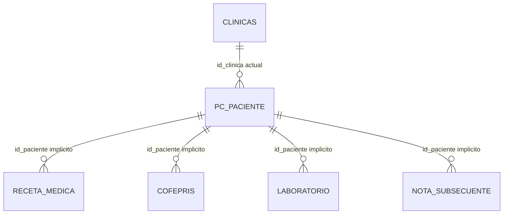

# TH-SEC-ARCH-01 V1.1 — Arquitectura de recetas, traslados y vinculación de pacientes externos

Fecha de corte: 2026-10-12  
Proyecto: Clínica del Dolor  
Alcance: Historia Clínica Tradicional y seguridad documental relacionada  
Implementación: **NO AUTORIZADA**  
Producción: **NO AUTORIZADA**

## A. Resumen ejecutivo

V1.1 actualiza la arquitectura V1.0 con los contratos funcionales aprobados posteriormente. La decisión nueva más importante es precisa: una receta externa es emitida por un médico de la propia clínica a una persona que todavía no tiene expediente registrado. No es una receta de un proveedor externo ni una receta global.

La persona puede registrarse posteriormente y solicitar una vinculación manual con su expediente, pero la vinculación no cambia la clínica emisora, el médico, la fecha, el contenido ni el documento original. La propiedad permanece en la clínica que emitió la receta. Si el expediente posterior pertenece a otra clínica, la asociación requiere un flujo explícito de verificación y autorización; no puede hacerla unilateralmente cualquier usuario que conozca un ID.

La arquitectura recomendada conserva el modelo híbrido de V1.0 y lo amplía con:

- una sola clínica activa por paciente;
- historial append-only de traslados;
- propiedad permanente por receta;
- entidad independiente para recetas externas sin expediente;
- tabla independiente de vinculación receta externa–expediente;
- evidencia de verificación de identidad;
- documento original privado con hash;
- autorización por recurso y operación;
- conciliación histórica exclusiva del superadministrador.

No se implementó ninguna parte. No se crearon tablas, columnas, pacientes, recetas, vínculos, migraciones, PDFs ni permisos.

## B. Contratos funcionales aprobados

### B.1 Una clínica activa por paciente

Un paciente registrado tiene una sola clínica activa. Los traslados A→B, A→B→C y B→A son eventos históricos separados. `pc_paciente.id_clinica` puede seguir representando el estado actual, pero no es owner histórico y sólo puede cambiar mediante un servicio transaccional de traslado aprobado.

No se diseñan asociaciones activas simultáneas. Si posteriormente se requieren, será una decisión nueva y no una inferencia de este documento.

### B.2 Propiedad permanente

Toda receta pertenece a la clínica donde fue emitida, independientemente de:

- la clínica actual del paciente;
- traslados posteriores;
- clínica actual del médico;
- cambios demográficos;
- vinculación posterior de una receta externa.

### B.3 Consulta histórica

La clínica actual puede consultar recetas históricas legítimamente asociadas al paciente y obtener una copia fiel para imprimir o descargar, siempre con autenticación y permisos. La clínica destino no puede editar, eliminar ni cambiar el emisor, la fecha, la clínica o el documento original.

La clínica anterior conserva acceso a las recetas que emitió, no a recetas posteriores de otras clínicas.

### B.4 Conciliación histórica

Una receta antigua sin clínica emisora verificable queda pendiente/bloqueada. No se utiliza la clínica actual, el médico actual, el nombre del paciente o el ID de URL para inferir propiedad. Sólo el superadministrador puede aprobar una conciliación con evidencia, responsable, fecha, justificación y auditoría.

## C. Definición definitiva de receta externa

Una receta externa es un documento emitido por un médico autorizado de Clínica del Dolor para una persona que todavía no está registrada en `pc_paciente`.

Por lo tanto, al emitirla:

- no se exige `id_paciente` ficticio;
- no se crea automáticamente un expediente completo;
- la receta tiene identidad documental propia;
- se conserva médico emisor, usuario creador, clínica emisora, fecha y datos consignados;
- se conserva el documento original y su integridad;
- otra clínica no obtiene acceso por conocer el ID;
- la ausencia de expediente no elimina la propiedad de la clínica emisora.

El término “externa” describe la ausencia de expediente registrado al momento de emisión, no un médico ajeno ni una receta global. Esta decisión reemplaza la interpretación ambigua de V1.0 para este tipo de registro.

## D. Arquitectura actual inspeccionada

### D.1 Preflight

| Dato | Resultado |
|---|---|
| Directorio | `C:\xampp\htdocs\clinica-dolor` |
| Rama | `Silvino` |
| HEAD | `1b08d9b4c41080c176fbe4588212863f3a1ac18c` |
| Base de sólo lectura | `clinica_dolor_demo_20261010_final` |
| Base prohibida para escrituras | `bd_clinica` |
| Motor/version | MariaDB 10.4.32, InnoDB |
| Worktree | Preservado; ya contenía cambios locales y archivos no rastreados |
| Escrituras en esta actualización | Ninguna |
| Entrevista Conversacional | Fuera de alcance y sin modificaciones |

### D.2 Evidencia de esquema

El entorno allowlisted contiene `clinicas`, `pc_paciente`, `receta_medica`, `cofepris`, `laboratorio`, `nota_subsecuente` y tablas de historia tradicional. No contiene `receta_medica_externos`, catálogos persistentes verificables de usuarios/roles ni tablas de traslados o conciliación.

Hechos relevantes:

- `pc_paciente.id` es PK y `id_clinica` es el vínculo actual a `clinicas.id`.
- `receta_medica.id` es PK; `id_paciente` está indexado, sin FK declarada observada.
- `receta_medica` no tiene clínica emisora, médico emisor, usuario creador, documento original ni hash.
- La existencia de `RecetaExternoModel` y de consultas a `receta_medica_externos` en el código no demuestra que esa tabla exista en el entorno permitido ni define su owner.
- La sesión Doctor se obtiene de claims JWT (`id_clinica`, `id_usuario`, `rol`, `vista`). El catálogo persistente de identidades no fue verificable en la base sintética.
- `RecetaController`, `PdfController` y `AuthMiddleware::assertPatientAccess()` actualmente resuelven acceso por clínica vigente del paciente; no por owner histórico.
- `RecetaExternoModel` actual espera datos de persona y contenido clínico, pero no captura owner de clínica, médico o paciente registrado.
- `pdfReceta()` regenera TCPDF desde datos actuales; no demuestra bytes originales.
- `DownloadController` recibe ruta/archivo y valida path/sesión, pero no un recurso clínico con autorización histórica.

Cuando un catálogo o tabla no está disponible, su estado es `SCHEMA_NOT_VERIFIED`; no se asume estructura por el nombre de un modelo.

### D.3 Diagrama actual



No existe en este diagrama una entidad actual que represente recetas externas sin expediente, propiedad permanente, traslado o documento original.

## E. Modelo propuesto

Todas las entidades, columnas, índices y restricciones de esta sección son **PROPUESTO — NO EXISTE EN EL ESQUEMA ACTUAL VERIFICADO**.

### E.1 Paciente y traslado

`paciente_traslado`:

- PK `id`;
- FK `id_paciente → pc_paciente.id`;
- FK `id_clinica_origen → clinicas.id`;
- FK `id_clinica_destino → clinicas.id`;
- `fecha_efectiva`, `estado`, `motivo_referencia`;
- `id_usuario_solicita`, `id_usuario_autoriza`, fechas de solicitud/aprobación;
- `created_at`, `cancelled_at`, `cancelled_by`;
- índices por paciente/fecha, origen/paciente, destino/paciente y estado.

Reglas: origen y destino distintos; un solo traslado aprobado vigente; como máximo un traslado pendiente compatible; aprobación y actualización de `pc_paciente.id_clinica` en una transacción con bloqueo de fila; nunca borrar eventos históricos.

### E.2 Receta interna y owner

`receta_medica_propiedad`:

- PK/FK `id_receta_medica → receta_medica.id`;
- FK `id_paciente_emision → pc_paciente.id` como snapshot de contexto;
- FK `id_clinica_emisora → clinicas.id`, inmutable;
- `id_medico_emisor` y `id_usuario_emisor`, sujetos a confirmar el catálogo real;
- `fecha_emision`, `id_documento_original`, `estado_propiedad`;
- `conciliacion_id`, `created_at`;
- restricción de una sola fila de owner por receta.

No se modifica el contenido clínico de `receta_medica` para cambiar owner.

### E.3 Receta externa sin expediente

`receta_externa`:

- PK `id_receta_externa` independiente de `pc_paciente`;
- FK `id_clinica_emisora → clinicas.id`;
- FK/referencia a médico y usuario emisor, pendiente de `SCHEMA_NOT_VERIFIED`;
- fecha y hora de emisión;
- snapshot de identidad consignada del receptor, separado de un paciente registrado;
- diagnóstico, medicamento, dosis, indicaciones y demás contenido autorizado;
- FK `id_documento_original`;
- estado documental y estado de procedencia;
- timestamps y auditoría de creación.

La tabla no exige `id_paciente`. El snapshot no se convierte automáticamente en una fila de pacientes ni se usa para autorizar una vinculación por coincidencia textual.

### E.4 Vinculación posterior

`receta_externa_vinculo_expediente`:

- PK `id`;
- FK `id_receta_externa → receta_externa.id_receta_externa`;
- FK `id_paciente → pc_paciente.id`;
- FK `id_verificacion_identidad`;
- estado `SOLICITADA`, `APROBADA`, `RECHAZADA`, `REVOCADA`;
- solicitante, verificador, aprobador y timestamps;
- motivo, versión y referencia de auditoría;
- índice por receta, paciente y estado;
- restricción de como máximo una asociación activa por receta.

La asociación es administrativa y auditable. Revocar crea un evento nuevo; no borra la asociación anterior ni el historial de accesos.

### E.5 Verificación de identidad

`receta_externa_verificacion_identidad`:

- PK `id`;
- receta y expediente involucrados;
- tipo de evidencia y referencia privada/hash;
- campos comparados, resultado, responsable, fecha y justificación;
- estado de revisión y auditoría.

No se recomienda guardar documentos de identidad en texto abierto. Los requisitos normativos y el tipo de evidencia deben validarse con el responsable especializado; esta arquitectura no inventa una regla clínica o legal.

### E.6 Documento original

`documento_receta_original`:

- PK `id`;
- `storage_key` privado aleatorio;
- SHA-256, tamaño, MIME, fecha de creación y estado;
- referencia a receta interna o externa mediante relaciones estrictas del owner;
- auditoría de carga y acceso.

El hash prueba integridad de los bytes almacenados desde el momento de cálculo; por sí solo no prueba autenticidad médica, identidad del firmante ni veracidad clínica.

### E.7 Conciliación y auditoría

`receta_conciliacion` conserva owner anterior, evidencia, clínica atribuida, responsable superadmin, fecha, justificación, resultado y decisiones posteriores.

`auditoria_operacion_sensible` conserva recurso, operación, actor, clínica, resultado, motivo, timestamp, request/correlation ID y referencia de evidencia, sin almacenar datos clínicos innecesarios.

## F. Historial de traslados y una clínica activa

Estados: `PENDIENTE → APROBADO`, `PENDIENTE → RECHAZADO`; un traslado aprobado puede quedar `CANCELADO` sólo mediante evento administrativo posterior. Un traslado pendiente no concede acceso nuevo. Un traslado concurrente se rechaza por lock/estado; no se permite que dos solicitudes cambien la clínica activa de forma contradictoria.

Escenarios:

| Escenario | Tratamiento |
|---|---|
| A→B | B pasa a ser clínica activa; A conserva sus recetas; B lee el historial autorizado sólo como destino |
| A→B→C | Se acumulan eventos; C lee recetas A/B autorizadas; A sólo sus recetas y B sólo sus recetas |
| B→A | Nuevo evento; no reescribe owners ni crea permisos retroactivos |
| Cancelado/rechazado | No cambia clínica ni permisos; se conserva auditoría |
| Antes del modelo | No se infiere owner; queda pendiente/bloqueado |
| Asociaciones simultáneas | No permitidas por DEC-01 |

## G. Propiedad histórica y acceso interclínica

El resolvedor futuro debe evaluar autenticación, rol/permiso, recurso, clínica emisora, clínica actual, traslado aprobado, estado del documento y operación.

| Operación | Clínica emisora | Clínica actual/destino | Clínica ajena |
|---|---|---|---|
| Consultar receta | Según permiso | Permitido como lectura histórica autorizada | Denegado |
| Imprimir copia | Permitido | Permitido como copia fiel | Denegado |
| Descargar copia | Permitido | Permitido como copia fiel y auditada | Denegado |
| Editar | Según contrato vigente | Denegado para receta ajena | Denegado |
| Eliminar | Según contrato vigente y auditoría | Denegado | Denegado |
| Cambiar owner/emisor | Denegado ordinariamente | Denegado | Denegado |
| Vincular externa a expediente | Rol aprobado pendiente | Requiere política cruzada | Denegado sin relación y autorización |
| Conciliar owner histórico | Sólo superadmin | Denegado | Denegado |

## H. Emisión externa y vinculación posterior

### H.1 Emisión sin expediente

1. Usuario autenticado con permiso de emisión inicia la receta.
2. El sistema crea una identidad propia de receta externa, sin `id_paciente` ficticio.
3. Registra clínica y médico emisor, contenido original y documento.
4. Persiste owner y documento en una transacción.
5. La receta queda visible sólo según owner y permisos.

### H.2 Solicitud de vinculación

La solicitud debe incluir receta, expediente destino, clínica emisora, solicitante, evidencia de identidad y motivo. El servidor verifica que ambos recursos existan, que la receta no tenga otra asociación activa, que el operador tenga la autoridad aprobada y que el documento esté íntegro.

No se autoriza automáticamente por nombre, apellidos, teléfono, correo o fecha de nacimiento. Esos datos pueden apoyar una verificación humana documentada, pero no deciden solos.

### H.3 Vinculación en la misma clínica

Si R1 pertenece a A y el expediente posterior está en A, el operador que resulte autorizado puede solicitar la asociación; debe existir verificación de identidad y auditoría. La receta conserva owner A y no se duplica como receta clínica.

### H.4 Vinculación cruzada A→B

Si R1 pertenece a A y el expediente está en B, B no puede vincular unilateralmente usando un ID. Propuesta segura:

1. B crea una solicitud sin revelar el contenido completo al operador no autorizado.
2. Se verifica la identidad del receptor y la existencia del expediente.
3. A, como clínica propietaria, confirma la procedencia/solicitud, o el superadmin decide si A no está disponible.
4. La aprobación final crea la vinculación sin cambiar owner.
5. B obtiene el acceso histórico de sólo lectura que DEC-03 permita.

La autoridad exacta y si se requiere doble aprobación son `USER_DECISION_REQUIRED`.

### H.5 Corrección y desvinculación

Una vinculación equivocada se corrige con una nueva operación `REVOCADA`/`CORREGIDA`, conservando el registro previo, la evidencia y los accesos. La autoridad debe ser la misma aprobada para vincular o una superior; no se recomienda permitir corrección unilateral por Doctor. Esta política requiere `USER_DECISION_REQUIRED`.

## I. Verificación de identidad

Propuesta funcional:

- comprobación humana documentada por operador autorizado;
- evidencia privada referenciada o hasheada;
- comparación de varios datos como apoyo, nunca coincidencia automática única;
- resultado explícito aprobado/rechazado;
- actor, fecha, motivo y auditoría;
- bloqueo ante conflicto o duplicidad.

El tipo de documento, retención, acceso y requisitos normativos necesitan validación especializada (`AUTH-02`).

## J. Documento PDF original

Para recetas nuevas, guardar bytes originales en almacenamiento privado, con clave no predecible, hash, tamaño, MIME, fecha y asociación al owner. La impresión/descarga entrega los mismos bytes o una copia fiel explícitamente identificada; no regenera desde datos modificables.

Clasificación legacy:

| Clase | Tratamiento |
|---|---|
| A — PDF original conservado | Verificar asociación, hash y autorización |
| B — recuperable con evidencia | Registrar tras revisión, sin inventar bytes |
| C — regenerable pero no fielmente demostrable | No presentarlo como original; bloquear copia fiel |
| D — inexistente | Estado `NO_DISPONIBLE`; no fabricar documento |

El hash garantiza integridad de una secuencia de bytes, no autenticidad médica ni autorización por sí mismo.

## K. Conciliación exclusiva del superadministrador

La conciliación de owner histórico y la vinculación de una receta externa son operaciones diferentes. Sólo la primera está aprobada exclusivamente para superadmin. Ambas deben conservar evidencia y auditoría, pero no comparten automáticamente permisos.

Flujo de conciliación: identificar recurso bloqueado, recopilar evidencia, proponer owner, verificar rol superadmin, aprobar/rechazar, registrar justificación y conservar snapshot. Nunca se modifica el contenido clínico, el médico emisor, la fecha o el PDF original.

## L. Datos históricos ambiguos y legacy

- Owner verificable: registrar propiedad sin alterar contenido.
- Owner documentalmente verificable: conciliación superadmin.
- Owner ambiguo/desconocido: pendiente/bloqueado.
- Receta externa antigua sin expediente: no crear paciente retroactivamente; clasificar y conciliar sólo con evidencia.
- Documento sin original: no llamar original a una regeneración.
- Asociación de persona ambigua: no vincular automáticamente.

No se actualiza masivamente `id_clinica` a partir de la clínica actual ni se crean pacientes ficticios para satisfacer FKs.

## M. Autorizaciones pendientes

| ID | Pregunta | Opciones | Recomendación |
|---|---|---|---|
| AUTH-01 | Quién vincula receta externa | Médico, admin de clínica, superadmin, doble aprobación | Operador autorizado de clínica + aprobación del owner o superadmin para cruce; nunca Doctor solo por defecto |
| AUTH-02 | Qué verifica identidad | Política documental, presencial o equivalente institucional | Verificación humana registrada; requisitos normativos por aprobar |
| AUTH-03 | A→B | B unilateral, A aprueba, superadmin, doble control | Solicitud B + confirmación A o superadmin; no acceso completo antes de aprobar |
| AUTH-04 | Corregir vínculo | Mismo rol, superior, superadmin | Revocación append-only por autoridad igual/superior; aprobación pendiente |
| AUTH-05 | Externa histórica no acreditable | Bloquear, cola superadmin, otra política | Bloquear y enviar a conciliación; no inventar identidad/owner |
| AUTH-06 | Legacy sin PDF | Regenerar, bloquear, copia derivada | Bloquear “original”; cualquier copia derivada debe rotularse y aprobarse |

Estas decisiones no se responden automáticamente en V1.1.

## N. Alternativas de vinculación

| Criterio | A — FK nullable en receta externa | B — tabla independiente de vínculo | C — híbrida |
|---|---|---|---|
| Integridad histórica | Media; mezcla emisión y asociación | Alta | Alta |
| Auditoría/desvinculación | Limitada; sobrescritura tentadora | Alta, eventos separados | Alta |
| Riesgo de asociación errónea | Alto si se actualiza un FK | Menor con estados/evidencia | Menor |
| Inmutabilidad documental | Puede conservarse aparte | Clara | Clara |
| Compatibilidad legacy | Simple para nuevas filas | Aditiva y gradual | Media |
| Rendimiento | Muy bueno | Bueno con índices | Bueno |
| Complejidad | Baja | Media | Media-alta |
| Recomendación | No | Sí | Sí para documento/owner |

Se recomienda **B para la vinculación**, combinada con el modelo híbrido de owner/documento de V1.0. La receta externa conserva su identidad y owner; la asociación con expediente es una entidad auditable independiente.

## O. Matriz de pruebas futuras

No se ejecuta en V1.1; sólo se diseña:

| Grupo | Casos y resultado esperado |
|---|---|
| Sin expediente | Emitir receta autorizada; owner/médico/documento correctos; clínica ajena denegada |
| Vinculación local | Identidad confirmada; una asociación activa; owner y bytes intactos |
| Vinculación cruzada | B solicita; A/superadmin autoriza; B lee copia; B no edita/elimina |
| Vinculación duplicada | Conflicto idempotente; no segunda asociación activa |
| Vinculación equivocada | Rechazo o revocación auditada; no borrado silencioso |
| Traslados | A→B, A→B→C, B→A, pendiente, cancelado, concurrencia |
| Propiedad | R1 A/R2 B/R3 C; cada owner conserva sólo lo propio y el actual lee históricos autorizados |
| PDF | Hash y bytes coinciden; legacy sin original no se presenta como original |
| Seguridad | anónimo, clínica ajena, IDs manipulados, POST, PDF y descarga directa denegados |
| Integridad | transacciones incompletas, locks, idempotencia, auditoría y ausencia de duplicados |

## P. Plan de migración V1.1, no ejecutado

1. Confirmar esquema real externo, usuarios, médicos, roles y documentos.
2. Aprobar el modelo y las autoridades AUTH-01–AUTH-06.
3. Crear tablas aditivas de traslado, owner, receta externa, vínculo, evidencia, documento y auditoría.
4. Registrar owner/documento de nuevas recetas internas y externas en la misma transacción.
5. Implementar autorización por recurso/operación.
6. Implementar emisión externa sin expediente.
7. Implementar solicitud y aprobación de vinculación.
8. Implementar traslados de una clínica activa con concurrencia controlada.
9. Clasificar y conciliar legacy sin reasignación automática.
10. Proteger PDF/descarga privada y retirar rutas legacy inseguras.
11. Ejecutar regresión de consultas, PDF, descargas, Doctor/D40 y seguridad entre clínicas.
12. Validar infraestructura equivalente a producción y aprobar separadamente.

Cada fase requiere dependencia, archivos afectados, datos afectados, riesgo, pruebas, reversión y autorización. Ninguna se ejecutó.

## Q. Impacto sobre la aplicación

| Archivo/componente | Cambio futuro | Estado V1.1 |
|---|---|---|
| `RecetaModel.php` | Consultar owner histórico y separar operaciones por recurso | No modificado |
| `RecetaExternoModel.php` | Sustituir contrato ambiguo por entidad externa propia | No modificado; esquema `SCHEMA_NOT_VERIFIED` |
| `ClinicaController.php` | Emisión externa, solicitud de vínculo y traslado | No modificado |
| `RecetaController.php` | Lectura histórica sólo lectura para destino | No modificado |
| `PdfController.php` | Servir documento original autorizado | No modificado |
| `BusquedasController.php` | Unificar autorización de AJAX | No modificado |
| `DownloadController.php` | Recibir documento/recurso, no sólo path/archivo | No modificado |
| `AuthMiddleware.php` | Delegar a resolvedor por recurso sin perder guardas | No modificado |
| Modelos de paciente | Transferencia transaccional | No modificado |
| Vistas Doctor/D14 | Estados pendiente/bloqueado y lectura histórica | No modificadas |
| Storage | Privado, hash y auditoría | No modificado |
| Entrevista Conversacional | Fuera de alcance | No modificada |

## R. Riesgos y mitigaciones

| ID | Severidad | Riesgo | Mitigación propuesta |
|---|---|---|---|
| V11-01 | Crítica | Owner histórico ausente | Tabla de propiedad y fail-closed |
| V11-02 | Crítica | Transferencia concurrente | Lock, estado y una clínica activa |
| V11-03 | Crítica | Externa sin expediente | Entidad propia sin FK a paciente |
| V11-04 | Crítica | Vinculación errónea | Verificación humana, aprobación y auditoría |
| V11-05 | Crítica | PDF regenerado presentado como original | Bytes privados + hash; legacy bloqueado |
| V11-06 | Crítica | Descarga por ruta/archivo | Autorización por documento/recurso |
| V11-07 | Alta | Rol de vinculación no definido | AUTH-01/03/04 pendientes; no otorgar permiso automático |
| V11-08 | Alta | Catálogos usuarios/médicos no verificados | Confirmar esquema antes de FKs |
| V11-09 | Alta | Recetas externas legacy ambiguas | Cola de conciliación; no reasignar |
| V11-10 | Crítica abierta | ACT-05C-02 documental | Fase independiente de seguridad |

Los riesgos no se convierten en remediaciones en esta fase.

## S. Diferencias V1.0 → V1.1

| V1.0 | Decisión nueva | Ajuste V1.1 | Impacto/Pendiente |
|---|---|---|---|
| Receta externa con owner no definido | Es emitida por médico de la clínica a persona no registrada | Nueva entidad independiente sin `id_paciente` obligatorio | Confirmar tabla/roles reales |
| Externa sin relación de paciente | Vinculación posterior autorizada | Tabla independiente de vínculo + verificación | AUTH-01–AUTH-04 pendientes |
| Externa tratada como esquema ambiguo | No es receta de tercero | Separar registrador, emisor, receptor y expediente | Migración legacy requiere clasificación |
| Traslado histórico | Una clínica activa | DEC-01 explícita y máquina de estados | No asociaciones simultáneas |
| Owner de receta | Híbrido interno | Se extiende a externa independiente | No implementar |
| Acceso cross-clinic | Lectura destino propuesta | Requiere vínculo legítimo para externas sin expediente | Política A→B pendiente |
| PDF original | Documento privado propuesto | Aplica a externas sin expediente desde emisión | Storage y retención pendientes |
| Conciliación | Sólo superadmin | Se distingue de vinculación de expediente | Mantener permisos separados |

V1.0 se conserva sin edición. V1.1 agrega precisión funcional y no constituye autorización de implementación.

## T. Decisiones todavía requeridas

- AUTH-01: rol autorizado para vincular.
- AUTH-02: controles de identidad y evidencia.
- AUTH-03: autorización de A cuando expediente está en B.
- AUTH-04: autoridad para corregir/desvincular.
- AUTH-05: tratamiento de externas históricas no acreditables.
- AUTH-06: documentos legacy sin original.
- Catálogo real de médicos, usuarios, roles y superadministrador.
- Retención, cifrado, backup y requisitos normativos de documentos de identidad.

## U. Recomendación final

Adoptar el modelo híbrido de V1.0, actualizado con una entidad propia para recetas externas sin expediente y una tabla independiente de vinculación posterior. Mantener `pc_paciente.id_clinica` como clínica activa, nunca como owner histórico. No permitir vinculación cruzada unilateral; exigir solicitud, verificación y aprobación según AUTH-03. Mantener fail-closed lo ambiguo y no ejecutar migraciones hasta aprobar AUTH-01–AUTH-06 y confirmar los esquemas ausentes.

## V. Resultado formal

```text
TH_SEC_ARCH_01_V1_1:
- STATUS: COMPLETE
- CURRENT_BRANCH: Silvino
- CURRENT_HEAD: 1b08d9b4c41080c176fbe4588212863f3a1ac18c
- WORKTREE_PRESERVED: YES
- ORIGINAL_ARCHITECTURE_PRESERVED: YES — V1.0 no fue sobrescrita
- APPROVED_DECISIONS_INCORPORATED: DEC-01 a DEC-05; una clínica activa; owner permanente; acceso histórico de sólo lectura; receta externa propia sin expediente; vinculación posterior autorizada como concepto
- SINGLE_ACTIVE_CLINIC: YES — sin asociaciones activas simultáneas
- TRANSFER_HISTORY: PROPUESTO append-only, transaccional y auditable
- INTERNAL_RECIPE_ORIGIN: PROPUESTO owner inmutable separado; actual no disponible
- EXTERNAL_RECIPE_DEFINITION: receta emitida por médico de la clínica a persona sin expediente registrado
- EXTERNAL_RECIPE_OWNERSHIP: clínica emisora y médico emisor permanentes; actual no verificable
- EXTERNAL_PATIENT_WITHOUT_RECORD: entidad de receta propia sin paciente ficticio
- LATER_PATIENT_REGISTRATION: vínculo posterior explícito, sin duplicar receta ni cambiar owner
- MANUAL_RECIPE_LINKING: PROPUESTO mediante tabla independiente, evidencia y auditoría
- IDENTITY_VERIFICATION_DESIGN: verificación humana registrada, evidencia privada/hash; política normativa pendiente
- CROSS_CLINIC_LINKING_DESIGN: solicitud de B + confirmación de A o superadmin; no unilateral; USER_DECISION_REQUIRED
- CLINIC_ORIGIN_IMMUTABILITY: YES en modelo propuesto; actual no disponible
- HISTORICAL_READ_ACCESS: owner y clínica actual autorizada, sólo lectura para destino; ajena denegada
- PDF_ORIGINAL_FIDELITY: bytes privados + hash para nuevos; legacy sin original no se presenta como original
- SUPERADMIN_RECONCILIATION: exclusiva para owner histórico ambiguo; separada de vinculación
- LEGACY_DATA_HANDLING: clasificar, bloquear ambiguos, conciliar sólo con evidencia; no reasignación automática
- PROPOSED_SCHEMA: traslado; owner interna; receta externa; vínculo; verificación; documento; conciliación; auditoría
- ARCHITECTURE_DIAGRAM: incluido en documento V1.1 y modelo de datos V1.1
- V1_0_V1_1_CHANGELOG: incluido en sección S
- USER_DECISIONS_REQUIRED: AUTH-01 a AUTH-06; catálogos reales; retención y normativa documental
- IMPLEMENTATION_STARTED: NO
- SCHEMA_CHANGES: NONE
- APPLICATION_CODE_CHANGES: NONE
- DATA_CHANGES: NONE
- DOCUMENTATION_CREATED: docs/architecture/TH_SEC_ARCH_01_HISTORICAL_RECIPE_OWNERSHIP_V1.1.md; docs/architecture/TH_SEC_ARCH_01_DATA_MODEL_PROPOSAL_V1.1.md; referencia en master
- GLOBAL_DIFF_CHECK: PASS — advertencias históricas LF/CRLF no corregidas
- PRODUCTION_READY: NO
```

No se modificó la Entrevista Conversacional, no se accedió a datos reales y no se realizaron commits, push o despliegues.
